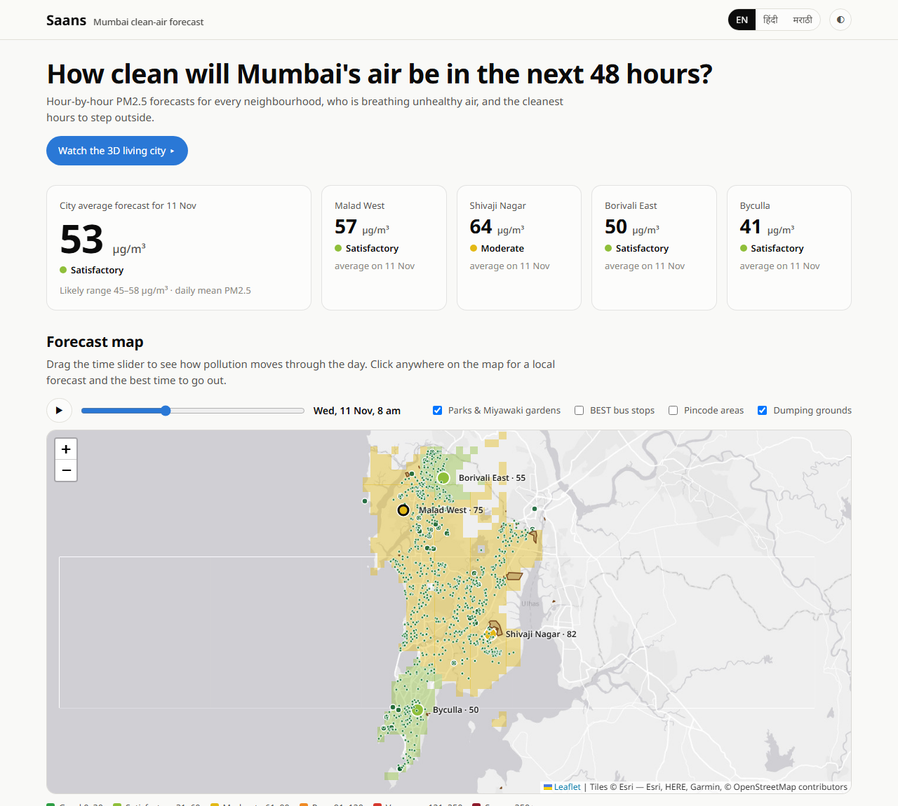

# Saans — Mumbai clean-air forecast

**Saans** (साँस, "breath") is a free web app that tells people in Mumbai **how clean the air will be over the next
48 hours, who is breathing unhealthy air, and the cleanest hours to step outside**, in English, हिंदी and मराठी.

**Live app:** https://shubham-tambei9.github.io/saans-mumbai-air/  ·  **3D living city:** https://shubham-tambei9.github.io/saans-mumbai-air/city.html  ·  Built for the *Google Mumbai Data Challenge: Air Quality Mapping & Forecasting* (Zindi × Google × ClimateVerse)



## What it does

| | |
|---|---|
| **Hour-by-hour forecast map** | PM2.5 for the next 2–3 days across Mumbai, coloured by the official CPCB air-quality bands, with a time slider and play button. |
| **Click anywhere** | A local forecast with its likely range, the **cleanest and most polluted 2-hour windows** each day, the CPCB health advice for that level, and the **nearest parks and Miyawaki gardens**. |
| **Who is breathing it?** | Combines the forecast with WorldPop 2026 population estimates to count the **people, children under 5 and adults over 65** living in each air-quality band, and ranks the most-exposed pincode areas. |
| **3D living city** | Mumbai rebuilt from **110,000 real building footprints with heights** (3D-GloBFP). Time plays by itself, wind-driven haze streams across the city, the **mixing-height lid** rises and falls with the forecast, and the day/night sky follows the real sun. Auto-tours each station. Switch towers to people, children or 65+. |
| **Pollution context** | Dumping grounds (Deonar, Kanjur, Mulund, Gorai…), BEST bus stops and pincode boundaries as map layers. |
| **After Diwali** | How quickly the air cleared after the firework nights of 2025 and 2026. |
| **Ask Saans (Gemini)** | Type a question such as *"My mother has asthma — can she walk tomorrow evening?"* and Gemini answers in your language, grounded in the hourly forecast for the selected place. It uses the visitor's own free Google AI Studio key, which stays in the browser. |
| **Three languages** | Every label, health message and date in English, Hindi and Marathi (`?lang=hi`, `?lang=mr`). |

## Why it matters

* Mumbai's winter air is **4–5× dirtier than its monsoon air** (city mean about 71 µg/m³ in Nov 2025 against 14–18 µg/m³ in Jun–Sep).
* Pollution is unequal. **Shivaji Nagar, 0.8 km from the Deonar dumping ground, averaged 76 µg/m³ in winter**, while the other three stations averaged 51–54.
* On **11 Nov 2026** the forecast puts about **570,000 people**, including **38,000 children under 5** and **51,000 adults over 65**, in **Moderate** air (daily mean above 60 µg/m³). These are WorldPop 2026 estimates for the mapped area. WorldPop models about 4 million people there, fewer than census-based estimates, so treat the counts as a lower bound.
* Most people only see *today's* AQI. A **next-48-hours** forecast with **specific clean hours** turns data into a decision: when to walk, when to take the kids to the park, when to close the windows.

## How it works

```
CPCB hourly PM2.5 (4 stations) ──┐
Open-Meteo weather forecasts ────┼──► LightGBM ensemble (log-target + CAMS-residual models, 5 seeds each,
CAMS air-quality forecasts ──────┘     recency-weighted; Diwali spikes masked)  ──► hourly forecast + range
                                                                                   │
WorldPop 2026 age structures ──┐                                                   ▼
BMC parks & Miyawaki gardens ──┤                    inverse-distance weighting to a 1 km grid
BEST bus stops & depots ───────┼──► creative/scripts ──► docs/data.js ──► docs/index.html (Leaflet, SVG charts,
Pincode boundaries ────────────┤                                         Gemini API, no server needed)
Overture landfill polygons ────┘
```

**Forecast accuracy.** We tested 1–3-day-ahead forecasts on five past periods (Nov 2025, Feb, Apr, Sep and Oct 2026),
measured as RMSE in µg/m³:

| Method | Mean RMSE |
|---|---|
| Repeat last week | 19.4 |
| CAMS forecast, bias-corrected | 17.4 |
| **Saans model** | **16.1** |

We also replayed Diwali 2025 to check the model's behaviour after festival smoke. CAMS inputs were essential there: 23.5 RMSE with them against 36.2 without.

## Data — all from the ClimateVerse *Google Air Quality Forecasting Challenge* collection

| Dataset | ClimateVerse DOI | Used for |
|---|---|---|
| CPCB / IITM / BMC hourly PM2.5, 4 stations | Zindi challenge data | training and observed values |
| Open-Meteo historical weather, forecast & historical-forecast APIs | [10.71646/XXOBKO](https://doi.org/10.71646/XXOBKO) | weather features |
| WorldPop Global2 age & sex structures 2026 (R2025A), India | [10.71646/KHOTYE](https://doi.org/10.71646/KHOTYE) | people, children <5 and adults 65+ per 1 km cell |
| BMC public parks, gardens, Miyawaki gardens and zoos (OpenCity) | [10.71646/8EKNG8](https://doi.org/10.71646/8EKNG8) | nearest clean-air spots |
| BEST bus stops and depots (OpenCity) | [10.71646/MEEUPH](https://doi.org/10.71646/MEEUPH) | map layer |
| India pincode maps 2025 (OpenCity / data.gov.in) | [10.71646/A6VENV](https://doi.org/10.71646/A6VENV) | exposure by pincode |
| 3D-GloBFP global building footprints with height (v2) | [10.71646/IEBMQY](https://doi.org/10.71646/IEBMQY) | 3D city (110,000 largest buildings) |
| Overture Maps landfill polygons (OpenStreetMap) | [10.71646/MWQNR8](https://doi.org/10.71646/MWQNR8) | dumping-ground layer |
| CAMS air-quality forecasts (Open-Meteo Air Quality API) | — | model feature |

## Google tools

* **Gemini API (Google AI Studio):** the in-app "Ask Saans" assistant answers in English, Hindi or Marathi. It automatically picks the newest Gemini Flash model the key can use.
* **Google Colab:** the forecasting notebook [`forecast/Mumbai_PM25_Final.ipynb`](forecast/Mumbai_PM25_Final.ipynb) runs top-to-bottom in Colab. [](https://colab.research.google.com/github/Shubham-Tambei9/saans-mumbai-air/blob/main/forecast/Mumbai_PM25_Final.ipynb)
* **Google Fonts (Noto Sans and Noto Sans Devanagari):** for clean Hindi and Marathi text.

## Run it yourself

```bash
# 1. Put the Zindi challenge files (Train.csv, Test.csv, SampleSubmission.csv, Stations.csv) in the repo root
pip install pandas numpy lightgbm requests rasterio shapely duckdb
python forecast/fetch_ext.py            # Open-Meteo weather + CAMS forecasts -> ext/
python forecast/final2.py               # LightGBM forecast -> submission.csv
# 2. ClimateVerse layers (downloads to creative/raw/, cleaned files to creative/data/)
python creative/scripts/places.py       # parks, bus stops, pincodes
python creative/scripts/landfills.py    # Overture landfill polygons
python creative/scripts/buildings.py   # 3D-GloBFP grid 1724 (download from figshare to creative/raw/globfp first)
python creative/scripts/pop.py          # WorldPop 1 km grid (download the ind_t_*_2026 1 km files to creative/raw/worldpop first)
# 3. Bundle everything for the web app
SAANS_SITE=docs python creative/scripts/build_aq.py
# open docs/index.html — it is a static page, no server needed
```

## Limitations

* There are only 4 monitoring stations, so neighbourhood values are **estimates from distance weighting**. Real air varies street by street.
* WorldPop 2026 values are modelled projections (release R2025A, labelled alpha), and they undercount Mumbai.
* 3D-GloBFP heights are model estimates for 2020. The 3D view draws the 110,000 largest buildings, 2.5× taller.
* Saans gives general guidance based on CPCB health advisories. **It is not a medical service.**
